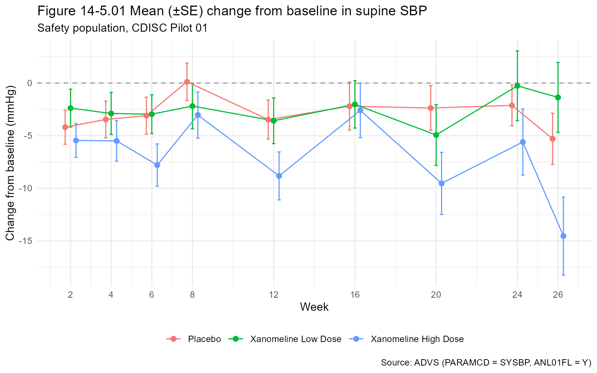

# CDISC Pilot 01: SDTM checks, ADaM (ADSL, ADVS) and TLFs in R

A small, reproducible workflow in R that starts from the public CDISC Pilot 01 SDTM data and ends with analysis datasets and tables, listings and figures (TLFs). It is a learning and portfolio project that follows the CDISC SDTM, ADaM and TLF steps.

## What it does
1. **SDTM source and checks** (`R/00`, `R/01`): downloads DM, EX, DS, VS and AE, then runs conformance checks (required variables, one record per subject, ISO 8601 dates, controlled terms, no orphan subjects, unique --SEQ). Results are in `output/sdtm_checks.csv`.
2. **ADSL** (`R/02`): subject-level analysis dataset with treatment, exposure dates, age groups, disposition and population flags. 306 subjects, 254 in the safety population.
3. **ADVS** (`R/03`): a Basic Data Structure (BDS) dataset for supine systolic and diastolic blood pressure and pulse, with baseline flag, BASE, CHG, PCHG and an analysis flag.
4. **TLFs** (`R/04`): demographics table (T1), change from baseline in systolic BP by visit (T2) and a mean change figure (F1).
5. **ADAE** (`R/05`): an Occurrence Data Structure (OCCDS) dataset for adverse events, with a treatment-emergent flag and first-occurrence flags per subject, system organ class and preferred term.
6. **AE TLFs** (`R/06`): overall summary of treatment-emergent adverse events (T3) and events by system organ class and preferred term (T4).

Derivation rules are written down in `docs/adam_specs.md`.

## Run it
```r
# install.packages(c("haven", "dplyr", "tidyr", "gt", "ggplot2", "tibble"))
source("run_all.R")   # run from the project folder
```
Outputs are written to `output/`. The raw XPT files are downloaded to `data/`, and the record-level analysis datasets (ADSL, ADVS, ADAE) are created on your own computer when you run the project. None of these data files are stored in this repository. Only the summary tables, the figure and the check results are included.

## Output preview
Safety population (N = 254) from the CDISC Pilot 01 public test data. These are practice results, not a clinical finding.

**Table 14-2.01 Demographics (excerpt)**

| | Placebo (N=86) | Xanomeline Low Dose (N=84) | Xanomeline High Dose (N=84) |
|---|---|---|---|
| Age, mean (SD) | 75.2 (8.6) | 75.7 (8.3) | 74.4 (7.9) |
| Female, n (%) | 53 (61.6%) | 50 (59.5%) | 40 (47.6%) |
| White, n (%) | 78 (90.7%) | 78 (92.9%) | 74 (88.1%) |

**Table 14-5.01 Change from baseline in supine systolic BP (mmHg), Week 12, n | mean (SD)**

| Placebo | Xanomeline Low Dose | Xanomeline High Dose |
|---|---|---|
| 68 \| -3.5 (15.3) | 52 \| -3.6 (15.7) | 50 \| -8.8 (16.1) |

**Table 14-3.01 Overall summary of treatment-emergent adverse events, n (%) of subjects**

| | Placebo (N=86) | Xanomeline Low Dose (N=84) | Xanomeline High Dose (N=84) |
|---|---|---|---|
| Any treatment-emergent AE | 65 (75.6%) | 77 (91.7%) | 75 (89.3%) |
| Any related AE (possible or probable) | 43 (50.0%) | 72 (85.7%) | 69 (82.1%) |
| Any severe AE | 5 (5.8%) | 16 (19.0%) | 8 (9.5%) |
| Any serious AE | 0 (0.0%) | 1 (1.2%) | 2 (2.4%) |

**Figure 14-5.01 Mean (SE) change from baseline in supine SBP**



The full tables are in `output/T1_demographics.html`, `output/T2_sbp_change.html`, `output/T3_ae_overall.html` and `output/T4_ae_soc_pt.html` (download and open them in a browser).

## Scope and limits
- The Pilot 01 SDTM datasets already exist. This project **checks** them and **derives ADaM from them**. It does not map raw data to SDTM, because the raw data are not public.
- Adverse-event start dates that are only a year or a year and month (26 records) are not imputed, so those events are not flagged as treatment-emergent. "Related" means possible or probable; remote and none are treated as not related.
- The results are for practice with public test data. They are not a clinical finding.
- ADaM and TLF steps follow the CDISC ADaM structure, but the datasets have not been through Pinnacle 21 validation or a define.xml build.

## Data source and independence
CDISC Pilot 01 public test data, downloaded from the PHUSE test data repository (MIT-licensed): https://github.com/phuse-org/phuse-scripts

This is an independent learning project. It is not affiliated with or endorsed by CDISC, PHUSE or any employer, and it contains no data from any hospital, study site or research project of the author.

## Author
Archana Anil Kumar
